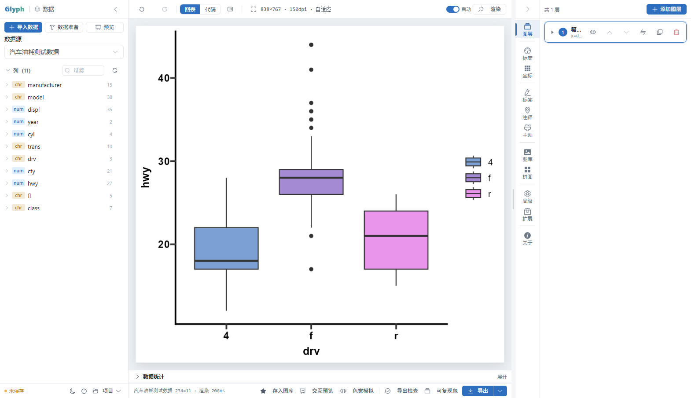
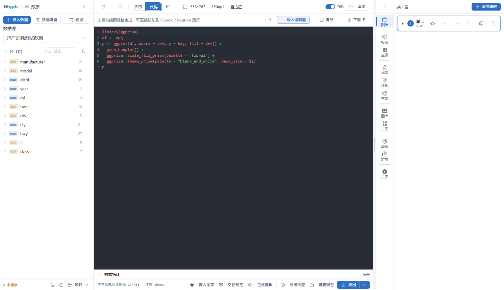
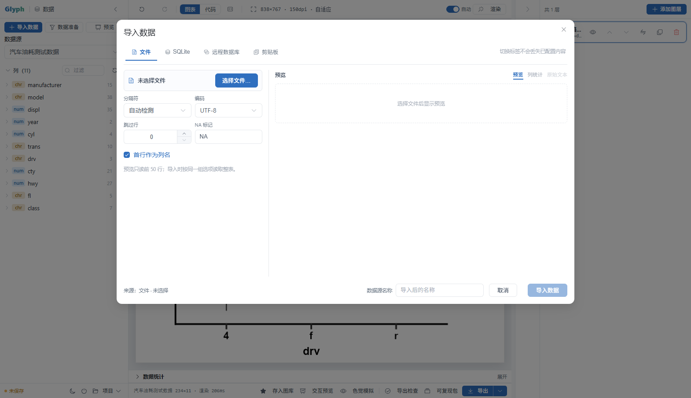
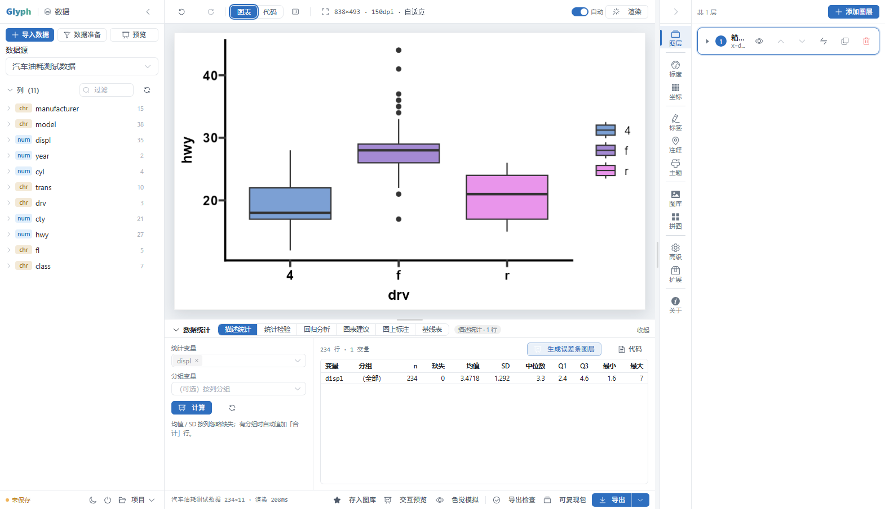
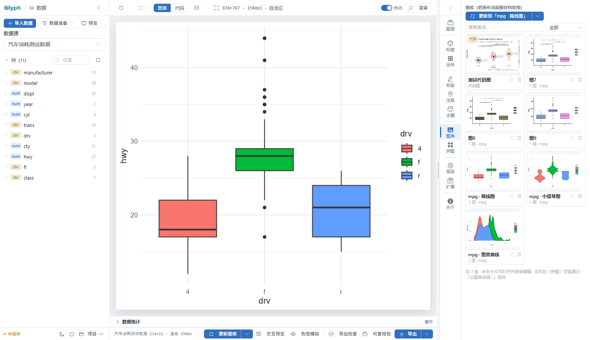
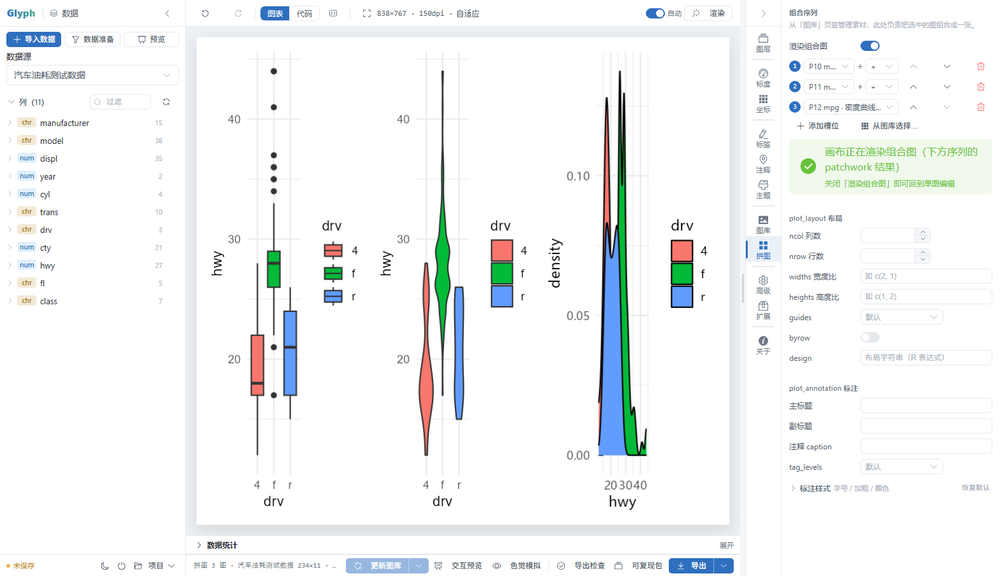
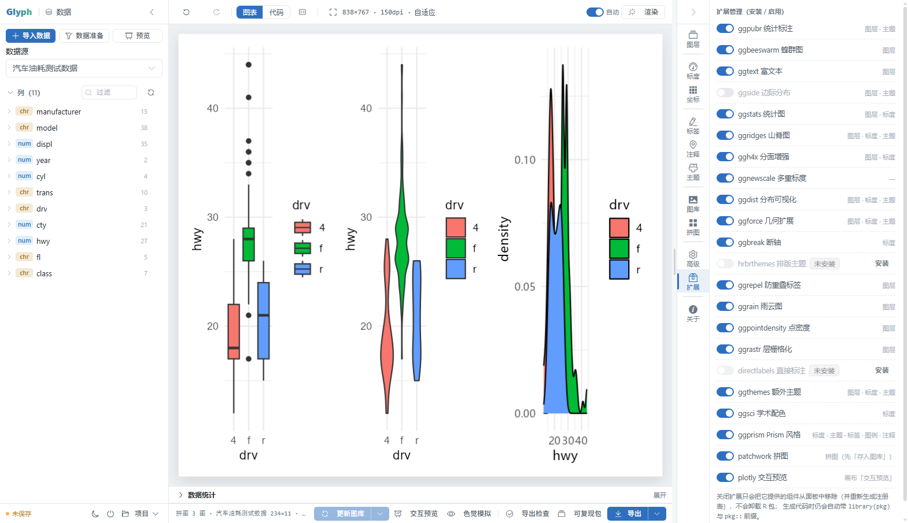
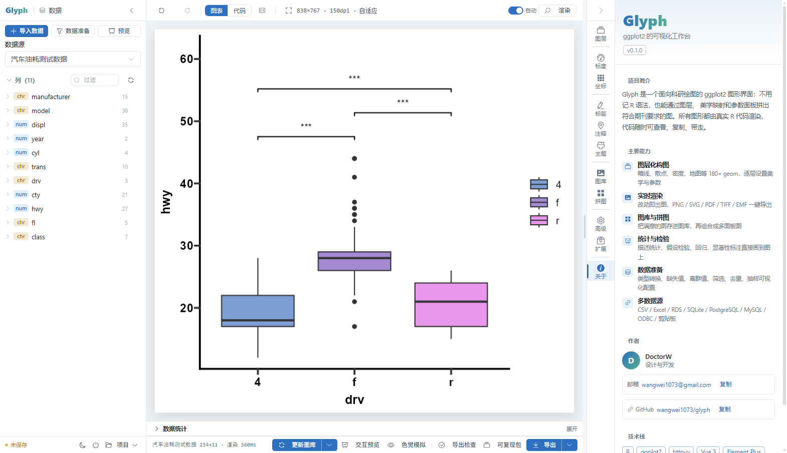

# Glyph · ggplot2 可视化工作台

> 用图形界面构建 ggplot2 图形，实时生成**规范、可复现的 R 代码**。



Glyph 是一个本地运行的科研绘图工具：左侧管理数据，中间是画布，右侧逐层设置图形。
所有图形都由真实的 R 代码渲染，代码随时可查看、复制、下载，粘贴到 RStudio / Positron 即可复现。

- **版本**：0.1.0
- **作者**：DoctorW
- **邮箱**：wangwei1073@gmail.com

---

## 目录

- [特色功能](#特色功能)
- [界面截图](#界面截图)
- [快速开始](#快速开始)
- [使用方式](#使用方式)
- [技术架构](#技术架构)
- [项目结构](#项目结构)
- [测试](#测试)
- [扩展机制](#扩展机制)
- [许可证](#许可证)

---

## 特色功能

### 数据接入

- **内置数据集**：40+ 个 ggplot2 / base R 数据集，开箱即用
- **文件导入**：CSV / TSV / TXT / XLSX / XLS / RDS / RData / JSON
- **SQLite**：选择 `.db` 文件后浏览表、预览 100 行再导入
- **远程数据库**：PostgreSQL / MySQL / MariaDB / ODBC，支持测试连接 → 表列表 → 只读预览 → 自定义 SELECT → 导入快照
- **剪贴板**：直接粘贴表格文本，自动识别分隔符
- 导入后记录数据来源，随项目保存，供图注与可复现包使用

### 数据准备

以**有序步骤**描述数据加工：类型转换 → 文本替换 → 离群值处理 → 新增列 → 缺失值填充 → 行筛选 → 去重 → 抽样。
每一步都显示影响（筛掉 N 行 / 新增列 / 抽样 N 行）并生成对应 R 代码，原始数据不被修改、可随时重置。

### 绘图

- **180+ geom**：覆盖 ggplot2 4.0 全部图形类型，并集成 ggrepel / ggpubr / ggridges / ggforce / ggdist / ggstats / ggside / ggrain / ggrastr 等扩展
- **逐层设置**：每层独立的美学映射（列 / 常量 / R 表达式三种模式）、geom 参数、stat、position
- **图形设置**：标度、坐标、分面、标签、注释、主题（含 Prism / 期刊风格主题与调色板）
- **统计**：描述统计、假设检验（含两两比较 p 值）、回归分析、图表建议、显著性标注、基线表；
  跑完描述统计可一键生成**误差条图层**（均值 ± 95%CI），配对检验后可生成**配对线图**（个体轨迹）
- **图库与拼图**：把满意的图存进图库，再组合成多面板图
- **导出**：PNG / SVG / PDF / TIFF / EMF，可设尺寸与 DPI；导出前提供检查（字体、分辨率、配色可读性）
- **可复现包**：一键打包数据、代码、图形与依赖说明

### 代码与扩展

- **实时代码**：图表 ↔ 代码双向切换，代码可直接编辑运行
- **可复现**：生成的代码包含 `library()`、数据读取、绘图与主题，独立可运行
- **扩展管理**：按需启用/安装扩展包，注册表自动发现新增 geom / 主题 / 调色板
- **插件**：附带 DSH 插件，可在宿主侧栏中直接打开 Glyph

### 界面

- 三栏布局：数据 / 画布 / 设置，左右面板可折叠、可拖拽调整宽度
- 亮色与暗色主题
- 色觉模拟预览（灰度 / 红绿 / 蓝黄），投稿前检查配色可读性

---

## 界面截图

### 图表视图

逐层构建图形，右侧实时调整美学与参数。


### 代码视图

同一张图对应的 R 代码，可复制、下载或载入编辑器继续修改。



### 导入数据

文件 / SQLite / 远程数据库 / 剪贴板四个入口，切换标签不丢失已配置内容。



### 数据统计

描述统计、假设检验、回归、图表建议、显著性标注与基线表。



### 图库

把画布上满意的图存入图库；卡片可直接打开继续编辑，也可在拼图页组合。
重新打开某个条目编辑后，底栏按钮会变成「更新图库」，下拉里可「另存为新条目」。



### 拼图

从图库按选择顺序加入槽位，一行内组合多张图；右侧可设置行列数、宽高比、guides、整体标题与标注样式。



### 扩展管理

按需启用扩展包：注册表会重新扫描并接入对应的 geom、主题与调色板；未安装的包提供一键安装。
关闭扩展只移除界面入口，不会卸载 R 包，已生成代码仍可运行。



### 关于



---

## 快速开始

### 环境要求

- **R ≥ 4.2**（推荐 4.6+）
- **ggplot2 ≥ 3.5**（推荐 4.0+）
- 扩展包按需安装：Glyph 会检测缺失的包并在界面中提示一键安装

### 启动

**Windows**：双击 `run_app.bat` —— 自动查找 R、启动服务并打开浏览器。

**其他平台**：

```bash
Rscript run.R            # 默认 http://127.0.0.1:4321
```

常用参数：

```bash
Rscript run.R --port 4322            # 指定端口
Rscript run.R --data-dir ~/glyph-ws  # 指定工作区目录
Rscript run.R --no-browser           # 不自动打开浏览器
```

> 首次运行会自动构建元数据注册表（扫描已安装的 ggplot2 与扩展包），约 2 秒。

### 前端构建（可选）

仓库默认不包含 `dist/`。若修改了前端源码：

```bash
cd frontend
npm install
npm run build      # 输出到 ../dist
```

`run.R` 在缺少 `dist/index.html` 时会给出提示。

### 发布打包

```bash
node tools/make_release.mjs            # 构建前端并打包
node tools/make_release.mjs --skip-build
```

产物输出到 `releases/glyph-<版本>.zip`。

---

## 使用方式

1. **导入数据**：左上「导入数据」，选择文件 / 数据库 / 剪贴板，预览后确认导入
2. **添加图层**：右上「+ 添加图层」，选择 geom，按需映射 x / y / 颜色 / 填充等
3. **调整设置**：右侧页签分别管理图层、标度、坐标、标签、注释、主题
4. **导出**：底栏「导出」，选择格式、尺寸与 DPI

图形渲染失败时，底栏会显示 R 的原始错误信息，便于定位问题。

---

## 技术架构

```
┌─────────────────────────────┐        HTTP/JSON        ┌──────────────────────────┐
│  Vue 3 + Element Plus       │  ───────────────────▶   │  R + httpuv              │
│  Pinia 状态 / CodeMirror 6  │  ◀───────────────────   │  spec → R 代码 → 渲染     │
└─────────────────────────────┘                         └──────────────────────────┘
```

- **前端**：Vue 3 `<script setup>`、Element Plus、Pinia、CodeMirror 6、Vite
- **后端**：R + httpuv，纯 R 实现；`spec`（声明式绘图规格）编译为可读 R 代码后 `eval` 渲染
- **单一渲染管线**：界面预览、代码展示、导出、可复现包使用同一份代码，保证所见即所得
- **元数据自省**：启动时扫描 ggplot2 与扩展包，生成 geom / stat / scale / theme 的注册表

---

## 项目结构

```
glyph/
├── R/                    # 后端：API、代码生成、数据、统计、渲染、工作区
│   ├── api.R             # HTTP 路由
│   ├── spec_to_code.R    # spec → R 代码
│   ├── registry_*.R      # 元数据注册表
│   ├── dataio.R          # 数据导入与数据准备
│   ├── stats_*.R         # 统计与检验
│   ├── render.R          # 渲染与导出
│   └── ...
├── frontend/             # 前端源码（Vue 3 + Vite）
│   └── src/components/   # 各功能面板
├── dist/                 # 前端构建产物（不纳入版本控制）
├── plugin/               # DSH 插件
├── tools/                # 辅助脚本（缩略图生成、发布打包等）
├── tests/                # R 与 Node 测试
├── run.R                 # 启动入口
├── run_app.bat           # Windows 启动器
└── run_tests.R           # 测试入口
```

工作区（默认安装目录，可用 `--data-dir` 指定）包含：

```
pins.json / pins/         # 图库
userdata/                 # 导入的数据
edits.json                # 数据准备记录
extensions.json           # 扩展开关
glyph.json                # 工作区信息
```

---

## 测试

```bash
Rscript run_tests.R            # 全部
Rscript run_tests.R spec       # 按关键字过滤
```

测试覆盖代码生成、主题、统计、数据导入、扩展探针与前端图表建议等。

---

## 扩展机制

Glyph 通过注册表自动发现扩展包提供的 geom、主题与调色板：

- 在「扩展」页签启用后，重新构建注册表即可使用
- 缺失依赖时提供一键安装
- 生成的代码会自动使用 `pkg::fn()` 限定名，脱离 Glyph 也能运行

---

## 许可证

本项目采用 **MIT License**。使用前请确认 `LICENSE` 文件是否存在；如需其他协议，请自行替换。

---

## 反馈

- 仓库：<https://github.com/wangwei1073/glyph>
- 邮箱：wangwei1073@gmail.com
- Issue / PR 欢迎提交
