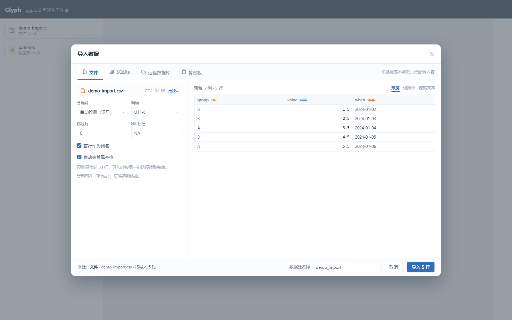
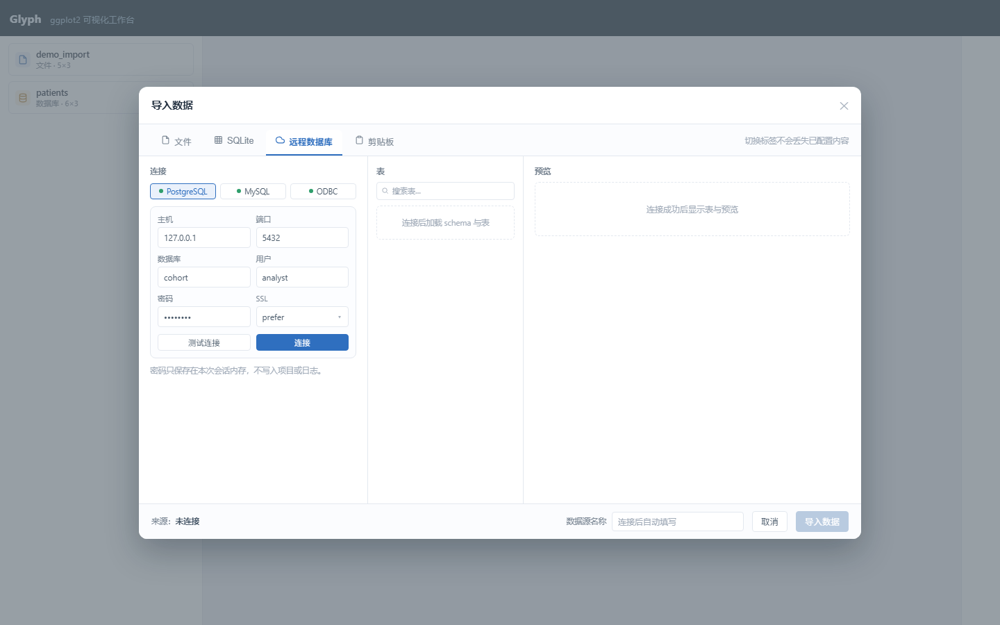
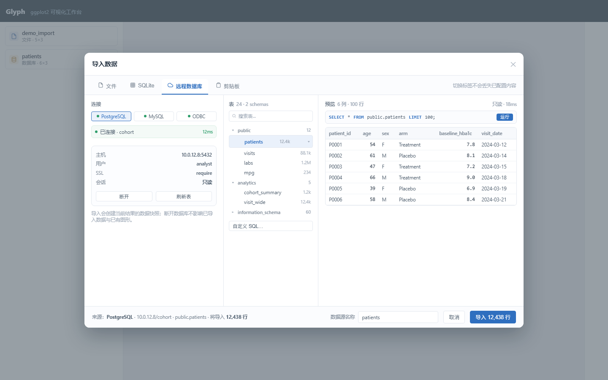
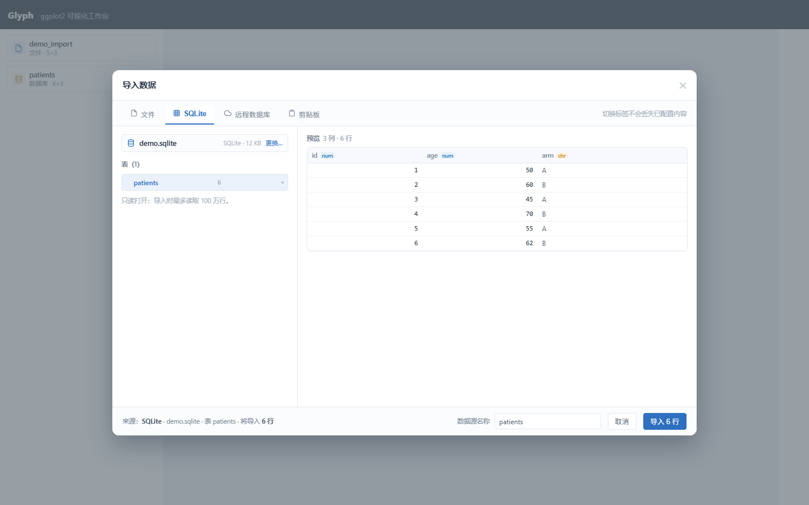

# 导入数据弹层 v2 · 设计稿与交互说明

> 状态：**已按本稿实现（2026-11-09）**。本文与四张设计稿配套，作为实现与验收依据。
> 设计稿（`docs/`）：
> - [文件](import_design_file.png)
> - [远程库 · 未连接](import_design_db_empty.png)
> - [远程库 · 已连接](import_design_db_connected.png)
> - [SQLite](import_design_sqlite.png)
>
> v1 的两步向导（选择来源 → 配置）作废；v2 改为**顶部标签 + 单屏工作区，没有第一步**。

---

## 一、设计原则

1. **一个弹层、四个标签、没有步骤条。** 打开即当前标签的工作区；切换标签不丢已填内容。
2. **文件是“配置 + 预览”，数据库是“连接 + 浏览 + 预览”。** 两种心智模型各自完整，不互相套用。
3. **导入按钮永远在右下角。** 它只对“当前标签当前选择”生效，不承担“下一步”。
4. **状态可见。** 未连接 / 连接中 / 已连接 / 表加载中 / SQL 模式 / 导入中 都有明确文案或骨架。
5. **默认安全。** 数据库只读、密码只在内存、SQL 单语句、预览与导入都有行数上限。

---

## 二、总体结构

```
┌ 导入数据 ─────────────────────────────────────────────── ✕ ┐
│ [▤ 文件] [▦ SQLite] [☁ 远程数据库] [◫ 剪贴板]   切换不丢配置 │
├─────────────────────────────────────────────────────────────┤
│  当前标签的工作区（见下）                                     │
├─────────────────────────────────────────────────────────────┤
│        来源：… · 将导入 N 行   数据源名称 [____]   [取消] [导入] │
└─────────────────────────────────────────────────────────────┘
```

- 弹层宽度 **1040px**，高度随内容（约 640–720），超出视口时内部滚动。
- 顶部标签：左侧四个 tab，右侧固定提示「切换标签不会丢失已配置内容」。
- 底部：**单行布局**，`来源摘要` 靠左，`数据源名称输入框 → 取消 → 导入` 靠右；名称标签与输入框同一行，不上下堆叠。
- 关闭（✕/Esc/取消）：**不导入**；数据库连接保留（见 4.4）。

---

## 三、文件标签



| 区域 | 内容 |
|---|---|
| 左栏（330px） | 文件卡片（名称 / 格式 / 大小 / **更换…**）、分隔符、编码、跳过行、NA 标记、首行表头、去空格、提示 |
| 右栏 | 预览头部（列数/行数）+ 页签「预览 / 列统计 / 原始文本」+ 表格 |
| 底部 | 名称、`来源：文件 · demo_import.csv · 将导入 5 行`、取消/导入 |

### 3.1 状态与规则

| 状态 | 表现 |
|---|---|
| 初始 | 未选文件：左栏只有「选择文件…」；右栏空态「选择文件后显示预览」；导入禁用 |
| 解析中 | 预览区骨架/spinner；按钮禁用 |
| 预览成功 | 显示前 50 行；列头带类型徽标；文本文件显示总行数，按钮「导入 N 行」 |
| 解析失败 | 右栏错误条（编码/分隔符建议），不阻断改选项重试 |
| 列类型覆盖 | 在「列统计」页签逐列下拉修改，改后自动重算预览；导入按覆盖类型转换 |
| 导入中 | 按钮 loading，禁止重复点击 |
| 导入成功 | 关闭弹层，左栏自动选中新数据源，toast「已导入：名称（N×M）」 |

### 3.1.1 空态文案

- 未选择文件时，文件卡片显示「未选择文件」，右侧是主按钮 **「选择文件…」**；
- 选中后才变成「文件名 + 大小 + 更换…」；
- 同理 SQLite：未选库时显示「未选择数据库」+「选择文件…」，选中后才是「.db 文件名 + 更换…」；
- **空态不出现「更换」**——没有东西可换。
### 3.2 交互细节

- 更换文件：保持当前标签，重置预览与类型覆盖。
- 选项变更：300–400ms 防抖重算预览；不改文件不重传。
- 「原始文本」仅文本类文件可用；Excel/SQLite/数据库禁用并给 tooltip。
- 总行数估算：文本按行数（减表头/跳过行）；Excel/RDS 无法快速计数时按钮显示「导入数据」。

---

## 四、远程数据库标签（核心改动）

### 4.1 未连接



| 区域 | 内容 |
|---|---|
| 左栏（330px） | 驱动选择（PostgreSQL / MySQL / ODBC，未安装显示「安装」）、连接卡片（主机/端口/库/用户/密码/SSL 或 DSN）、测试连接 / 连接、安全提示 |
| 中栏（224px） | 表：搜索框 + 空态「连接后加载 schema 与表」 |
| 右栏 | 预览空态「连接成功后显示表与预览」 |
| 底部 | 名称禁用（连接后自动填）、`来源：未连接`、导入禁用 |

### 4.2 已连接



| 区域 | 内容 |
|---|---|
| 左栏 | 驱动标签 + **已连接徽标（库名 / 耗时）** + 连接摘要（host:port、用户、SSL、只读）+ 断开 / 刷新表 |
| 中栏 | 表树：按 schema 分组（`public` / `analytics` / 折叠 `information_schema`），可搜索；每表显示估算行数（带 `≈` 含义在 tooltip 说明） |
| 右栏 | 顶部 SQL 条（当前表的 `SELECT … LIMIT 100`，可编辑 → 进入 SQL 模式）+ 结果表；右上显示「只读 · 18ms」 |
| 底部 | 名称自动为表名、`来源：PostgreSQL · host/db · schema.table · 将导入 12,438 行`、导入 N 行 |

### 4.3 交互规则

1. 点表 → 右栏立即预览 100 行；SQL 条同步为该表的查询。
2. 点 SQL 条或「自定义 SQL…」→ 右栏变 SQL 编辑模式：多行输入 + 运行；只允许单条 `SELECT/WITH`；自动包一层 `LIMIT 100`。
3. SQL 运行成功 → 预览更新；底部摘要变「自定义查询」，导入按钮按当前结果。
4. 表搜索：仅前端过滤（表多时后端可分页，P2）。
5. 表行数为估算值（information_schema），真实行数以预览/导入为准，tooltip 注明。
6. 导入：按当前表或当前 SQL 结果创建快照；成功后关闭弹层并选中；来源写进 `origin`。
7. 断开：清空表/预览/SQL，回到未连接态；已导入数据不受影响。

### 4.4 连接生命周期（决策）

- **关闭弹层不断开**；连接保留在当前进程内存，重新打开该标签仍显示「已连接」。
- 断开方式：显式「断开」、切换驱动、程序退出。
- 密码不回传前端、不写项目/日志；刷新页面会丢失连接（前端只持有 connId，后端重启即失效）——这是有意的安全边界。

### 4.5 错误与空态

| 场景 | 文案位置 |
|---|---|
| 驱动未安装 | 驱动行「未安装」+ 左栏警告条「立即安装」 |
| 测试连接失败 | 左栏错误条，显示服务端原始信息（密码已脱敏） |
| 连接超时 | 同上，附「检查主机/端口/防火墙」 |
| 表为空 | 中栏「该 schema 没有表」 |
| SQL 非 SELECT | 右栏错误条「只允许单条 SELECT / WITH」 |
| 预览超时 | 右栏错误条 + 建议加 LIMIT |
| 导入失败 | 弹层内错误条，不关闭，可重试 |

---

## 五、SQLite 标签



- 左栏：数据库文件卡片（更换…）、表列表（含行数）、只读提示。
- 右栏：预览 100 行（带类型徽标）。
- 底部：名称、`来源：SQLite · demo.sqlite · 表 patients · 将导入 6 行`。
- 驱动未安装：左栏显示安装按钮，装完自动加载表。
- 与远程库共享“左选中 → 右预览”的交互，不共享连接表单。

---

## 六、剪贴板标签

- 左栏：多行文本框（CSV/TSV），提示「第一行为列名」。
- 右栏：解析后预览（复用文件解析逻辑）或空态。
- 底部：名称、`来源：剪贴板`、导入。
- 粘贴内容过大（>5MB）给出警告。

---

## 七、导入与来源

| 规则 | 说明 |
|---|---|
| 快照 | 导入即落盘 RDS，项目内嵌；数据库断开/文件删除不影响已有图 |
| 命名 | **可编辑输入框**（不是只读展示）：默认自动填充，用户可改；规则见 7.1 |
| 来源 | `origin = {kind: file/sqlite/db, file/table/schema/host, importedAt}`，进图注与可复现包 |
| 重复导入 | 允许同名，列表按 id 区分；后续可加「替换当前数据源」 |

### 7.1 数据源名称规则

- 底部「数据源名称」是**可编辑输入框**，不是只读展示；设计稿里没有画光标，实际获得焦点后有输入光标。
- **默认值**：文件去扩展名；SQLite/远程库用表名；自定义 SQL 用「查询结果」。
- **自动覆盖**：用户**没有手动改过**时，切换表/文件会自动更新默认名；一旦手动编辑过，后续切换不再覆盖（dirty 标记）。
- **校验**：去首尾空格；为空时回退到默认名；最长 60 字符；允许重名（列表按 id 区分，不阻止导入）。
- **生效时机**：点「导入」时才写入；关闭弹层丢弃未导入的改名。
- 改名只影响当前数据源显示名，不改变 `origin` 里的原始文件/表信息（图注仍能写出来源）。
| 导入后 | 关闭弹层 + 自动选中新源 + toast；不自动建图层 |

---

## 七点五、按钮与控件规则

1. **数据库驱动选择组**（PostgreSQL / MySQL / ODBC）：每个按钮 **等宽**，`flex: 1` 平均占满所在列宽，不按文字长度收缩。
2. **成对操作按钮**（测试连接 / 连接、断开 / 刷新表）：同样等宽均分，占满所在列宽。
3. **底部主次操作**（取消 / 导入 N 行）：**不拉伸**，按内容宽度靠右排列，主按钮在最后。
4. **表格行内/图标按钮**（复制、删除、展开）：保持内容宽度，不参与均分。
5. 等宽按钮内部文字超出时用省略号 + tooltip，不换行撑高按钮。
6. **顶部来源标签按内容宽度、左对齐**：不拉伸、不铺满，标签之间固定 4px 间距；右侧放「切换标签不会丢失已配置内容」提示。
7. **底部栏单行布局**：来源摘要**靠左**，`数据源名称 [输入框] [取消] [导入 N 行]` **靠右**；名称标签在输入框左侧内联，禁止上下堆叠或折行；来源过长时省略号截断并给 tooltip。
8. **禁止使用 emoji**：图标一律用 Element Plus 图标库或内联 SVG（如搜索用 `Search` 图标，文件用 `Document`，数据库用 `Coin`）。
   不要用 🔍、☁、📄、⌘ 这类字符充当图标——不同系统字体渲染不一致，且不符合产品气质。

> 实现提示：按钮组容器 `display:flex; gap:8px`，子项 `flex:1; min-width:0; justify-content:center`；
> 不要给按钮设固定 `width`，也不要在组内用 `margin-left:auto` 把单个按钮推开。
## 八、键盘与可访问性

- `Esc`：关闭弹层（导入中禁用）。
- `Enter`：在连接表单触发「连接」；在 SQL 编辑器中 `Ctrl/Cmd+Enter` 运行。
- 所有图标按钮有 `title`/`aria-label`；类型徽标不只靠颜色区分（带文字 num/chr）。
- 焦点顺序：标签 → 左栏表单 → 中栏表 → 右栏预览 → 底部按钮。

---

## 九、与当前实现的差异（改造清单）

> 当前工作区里的 P1 实现是“两步向导 + 三栏嵌在第二步”，需要按 v2 调整：

1. 删除步骤条与“选择来源”步骤；改为顶部四个标签（文件/SQLite/远程库/剪贴板）。
2. 远程库点开即三栏工作区（未连接也显示三栏空态），不再需要“连接数据库…”按钮。
3. 已连接态左栏改为“连接摘要卡片”（不再保留可编辑表单），提供断开/刷新表。
4. 中栏表列表改成分组 schema 树 + 搜索框；行数加估算标识。
5. 右栏表预览时显示只读 SQL 条（当前表查询），点击进入 SQL 编辑模式。
6. 底部固定“名称 + 来源摘要 + 导入 N 行”；导入按钮不再出现在右栏顶部。
7. 文件标签保持现有 P0 能力，仅去掉步骤条、补“更换…/列统计/原始文本”的固定位置。
8. 连接生命周期按 4.4 实现（关闭弹层不断开）。

---

## 十、决策记录（原 5 个问题）

| 问题 | 决定 |
|---|---|
| 是否无步骤 + 顶部标签 | **是**，方案 A |
| 连接生命周期 | 保留到进程退出或显式断开；关闭弹层不断开 |
| 导入后是否关闭 | **是**，关闭并自动选中新数据源 |
| 已连接时左栏形态 | **摘要卡片**（库/主机/用户/SSL/只读）+ 断开/刷新，不保留可编辑表单 |
| 自定义 SQL 位置 | 右栏 **SQL 条常驻**；点击/“自定义 SQL…”进入编辑模式，表预览与 SQL 结果共用同一预览区 |

---

## 十一、验收清单

- [ ] 打开弹层没有步骤条；四个标签常驻。
- [ ] 远程库未连接/已连接两种状态与设计稿一致（三栏 + 底部摘要）。
- [ ] 点表 1s 内出预览；SQL 条内容与所选表一致。
- [ ] 非 SELECT / 多语句被拒绝且错误可读。
- [ ] 导入后左栏出现新源、来源记录正确、断开数据库后图仍可渲染。
- [ ] 文件标签的覆盖类型、列统计、原始文本可用。
- [ ] 关闭弹层再打开，远程库仍显示已连接；断开后回到未连接态。
